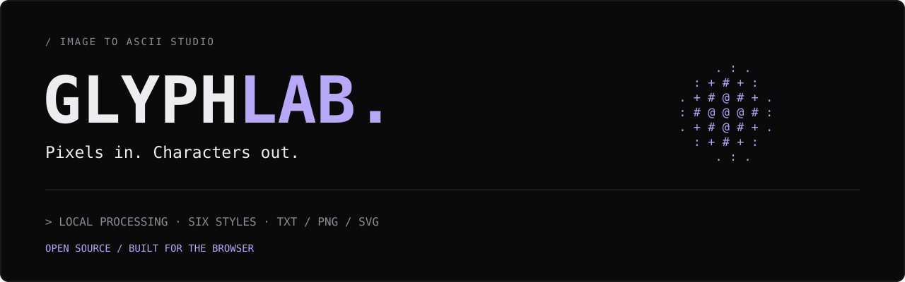
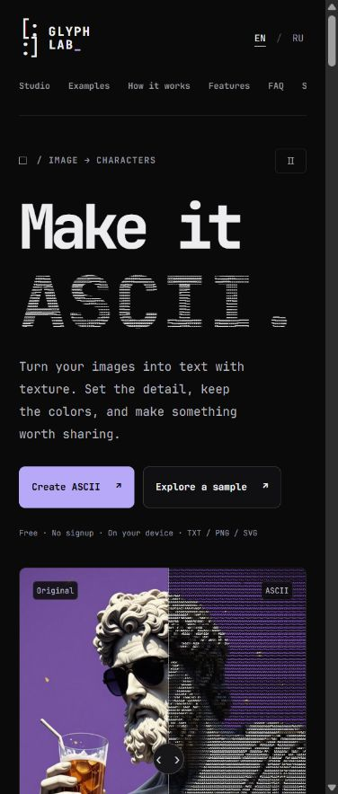

<p align="center">
  
</p>

<p align="center">
  A small studio for turning images into character art.<br>
  Upload. Refine. Export. All in your browser.
</p>

<p align="center">
  <a href="https://glyph-lab-livid.vercel.app/"><strong>Open the studio ↗</strong></a>
  &nbsp; · &nbsp;
  <a href="#quick-start">Run locally</a>
  &nbsp; · &nbsp;
  <a href="dist/LICENSE.txt">MIT license</a>
</p>

---

## / FIRST LOOK

<p align="center">
  <a href="https://glyph-lab-livid.vercel.app/">
    
  </a>
</p>

<p align="center"><sub>Actual screenshot of the live site · Click to open the studio ↗</sub></p>

## / THE STUDIO

**Your image, rebuilt one character at a time.**

Convert JPG, PNG, WebP and GIF images into ASCII art. Explore a preset, tune the character density, and take the result to a terminal, a README, a poster or a web page.

No account. No API key. No image upload to a server.

| Make it yours | Take it with you |
| :--- | :--- |
| **40–280 columns** — compact text or detailed artwork | **Copy / TXT** — portable monochrome character art |
| **Six character styles** — including Color ink | **PNG** — ready-to-use raster artwork |
| **Color, inversion and dithering** | **SVG** — scalable artwork made of text |
| **Brightness, contrast, cell aspect and ink lift** | **Local processing** — images stay on your device |

## / FROM PIXELS TO GLYPHS

1. **Upload** an image, drag and drop, paste from your clipboard, or choose a sample.
2. **Refine** the width, preset and character style. Drag the comparison divider to inspect the conversion.
3. **Export** as TXT, PNG or SVG, or copy the text directly.

> Color ink is preserved in PNG and SVG. Copy and TXT use a brightness-based monochrome character ramp.

## Quick start

Plain HTML, CSS and JavaScript. No build step or package installation.

```sh
git clone https://github.com/yessensiv/glyph-lab.git
cd glyph-lab/dist
python -m http.server 8080
```

Open **[localhost:8080](http://localhost:8080)**. Any static HTTP server works.

## / UNDER THE HOOD

| File | Purpose |
| :--- | :--- |
| `dist/index.html` | Page structure and content |
| `dist/style.css` + `refined.css` | Responsive layout, typography and composition |
| `dist/app.js` | Conversion, controls, translation and exports |
| `dist/title-motion.js` | Animated ASCII headline |
| `dist/assets/` | Samples, icons and local fonts |
| `vercel.json` | Static deployment configuration |

JetBrains Mono, a dark terminal palette and a lavender accent. English and Russian interfaces. The animated headline includes a pause control and respects reduced-motion preferences.

## / DEPLOY

**Live:** [glyph-lab-livid.vercel.app](https://glyph-lab-livid.vercel.app/)

Import this repository into Vercel. The included `vercel.json` serves `dist` without a build or install command.

| Setting | Value |
| :--- | :--- |
| Framework | Other |
| Output directory | `dist` |
| Build / install commands | None |

## / CONTRIBUTE

Bug reports, preset ideas and improvements are welcome. [Open an issue](https://github.com/yessensiv/glyph-lab/issues) or submit a pull request. Include a short description and a screenshot when changing the interface.

## / LICENSE

Code: [MIT](dist/LICENSE.txt). Bundled font: [SIL Open Font License](dist/assets/fonts/OFL.txt).

Sample image rights remain with their respective owners; the code license does not grant rights to these images.

---

<p align="center"><sub>GLYPH LAB · Pixels in. Characters out.</sub></p>
